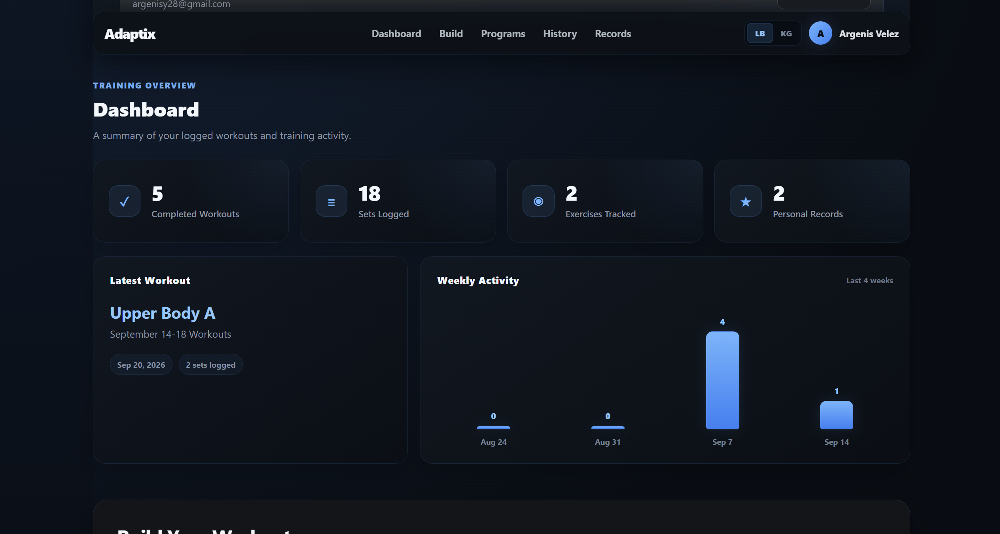
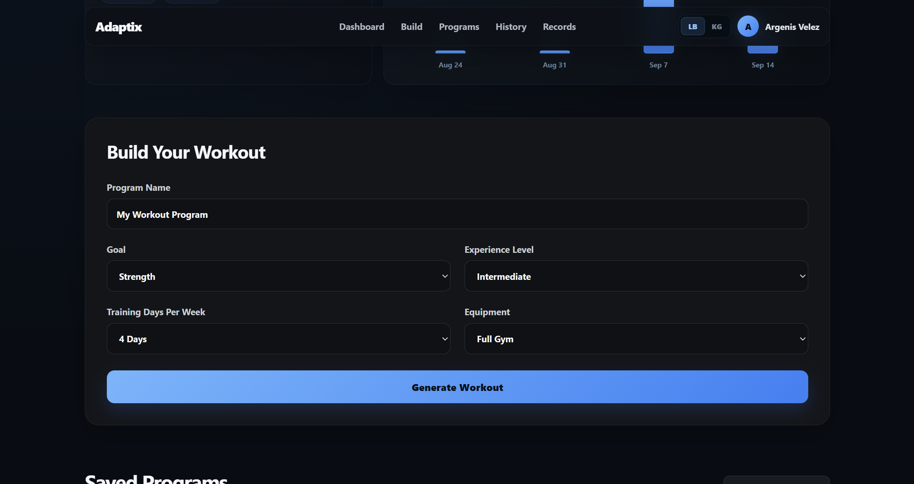
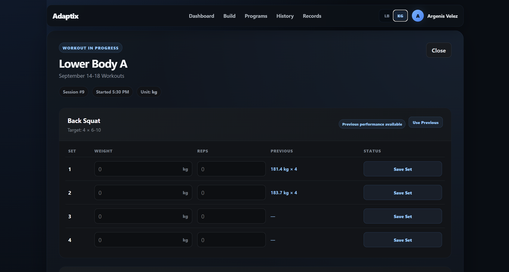
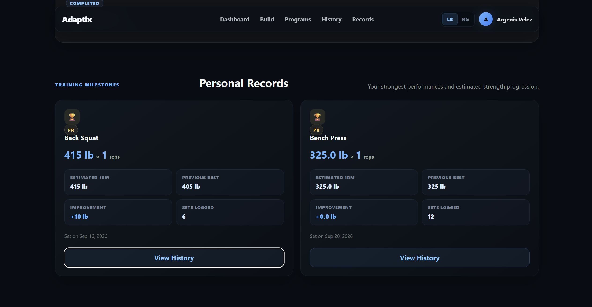
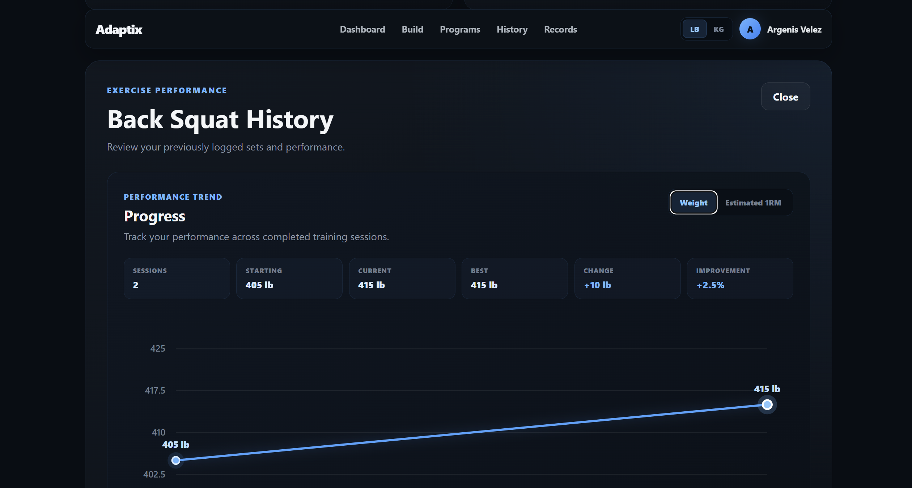

# Adaptix

A workout planner and training log. You tell it your goal, experience level, how many days a week you can train, and what equipment you have; it builds a program. Then you log your sets against that program and it keeps track of your history, PRs, and progress per exercise.

Built with React + TypeScript on the front, FastAPI on the back, and PostgreSQL for storage.



## What it does

- **Builds a program.** Picks a split (full body, upper/lower, etc.) based on your days per week and experience, then fills each day with exercises, sets, rep ranges, and rest times that fit your goal and equipment. This is rule-based, not ML.
- **Tracks workouts.** Start a day from a saved program and log weight × reps for each set. It shows what you did last time for each exercise, and **Use Previous** fills it in for you.
- **Finds PRs.** Personal records are computed from your history, with the previous best and estimated 1RM next to each one.
- **Charts progress.** Each exercise has its own history page with a chart you can switch between top weight and estimated 1RM.
- **Handles lb and kg.** Pick a unit and everything displays in it. More on how that works below.

| Workout builder | Tracker | Personal records | Exercise progress |
| --- | --- | --- | --- |
|  |  |  |  |

More screenshots are in [`screenshots/`](screenshots/).

## A few design decisions

**Weights are stored in the unit they were logged in.** Each set log keeps its original unit, and conversion only happens in the frontend (`frontend/src/utils/weight.ts`). Switching from lb to kg never rewrites the database, and a history with mixed units still compares correctly when finding PRs.

**History outlives programs.** Deleting a saved program doesn't wipe the sessions you logged with it. Session data keeps enough exercise info on its own to stay readable.

**Estimated 1RM uses the Epley formula:** `weight × (1 + reps / 30)`. A single rep counts as its own 1RM.

## Running it locally

You'll need Python 3.11+, Node.js, and PostgreSQL.

**1. Create the databases** (one for dev, one for tests):

```sql
CREATE DATABASE personalized_workout_app;
CREATE DATABASE personalized_workout_test;
```

**2. Add a `.env` file** in the project root:

```env
DB_HOST=localhost
DB_PORT=5432
DB_NAME=personalized_workout_app
DB_USER=your_postgres_user
DB_PASSWORD=your_postgres_password
TEST_DB_NAME=personalized_workout_test
```

**3. Install dependencies and set up the schema:**

```bash
pip install -r requirements.txt psycopg2-binary
python -m backend.init_db

cd frontend && npm install
```

**4. Start both servers** (in separate terminals):

```bash
# from the project root
python -m uvicorn backend.main:app --reload    # http://127.0.0.1:8000  (docs at /docs)

# from frontend/
npm run dev                                    # http://localhost:5173
```

## Tests

```bash
python -m pytest -q      # backend, runs against the test database

cd frontend
npm run lint
npm run build
```

There are 29 backend tests covering the recommender, the generator, the repositories, and the API. The frontend doesn't have tests yet.

## API

The full interactive reference is at `/docs` once the backend is running. The main routes:

| Method | Route | |
| --- | --- | --- |
| `POST` | `/api/account/start` | Start with an email; creates the user if it's new |
| `GET` `PUT` `DELETE` | `/api/users/{user_id}` | User profile |
| `POST` | `/api/workouts/preview` | Generate a program without saving it |
| `GET` `POST` | `/api/users/{user_id}/workouts` | List or save programs |
| `DELETE` | `/api/users/{user_id}/workouts/{program_id}` | Delete a program |
| `GET` `POST` | `/api/users/{user_id}/sessions` | List or start sessions |
| `POST` | `/api/users/{user_id}/sessions/{session_id}/sets` | Log a set |
| `PUT` | `/api/users/{user_id}/sessions/{session_id}/complete` | Finish a session |

## Project layout

```text
backend/
  main.py                        FastAPI app and routes
  recommender.py                 picks the training split
  workout_generator.py           builds each day's exercises
  exercise_library.py            exercises grouped by movement pattern and equipment
  *_repository.py                database access
  schema.sql, init_db.py         schema and setup
frontend/src/
  components/                    one component per screen
  utils/weight.ts                lb/kg conversion
tests/                           pytest suite
```

## What's next

- Real authentication (right now there are user profiles but no passwords)
- Editing programs and adding custom exercises
- Frontend tests
- Deploying it somewhere

---

Built by Argenis Y. Vélez Álvarez, Computer Engineering student at the Polytechnic University of Puerto Rico.
